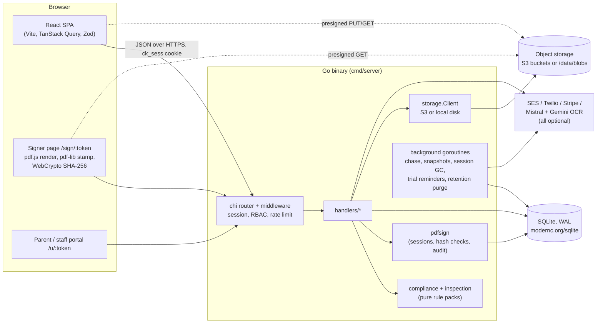
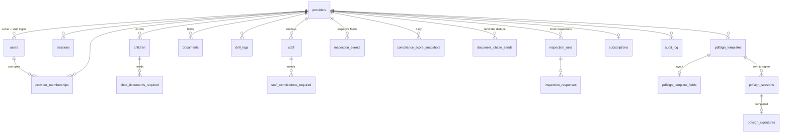
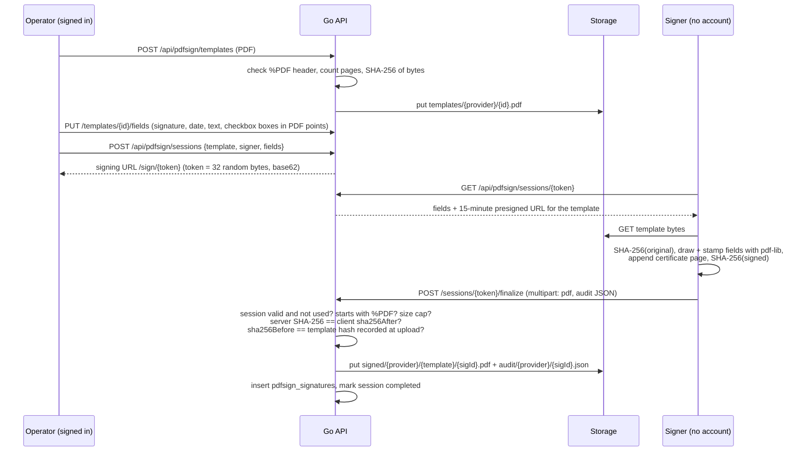

# ComplianceKit architecture

ComplianceKit helps a licensed child care center stay ready for a state licensing inspection on any given day, not just the week before one. This document covers what the system does, how it is built, and why the backend is written in Go, with each claim tied to a file in this repository.

- **Live demo:** https://compliancekit.levelbrook.com (click "Explore the live demo" for a private sandbox, or sign in with `demo@example.com` / `inspection-ready`)
- **Code:** `backend/` (Go), `frontend/` (React + TypeScript)
- **Author:** Patrick Donahue

All the data in the demo is fictional, and email, SMS and payments are switched off. More on that under [Deployment](#10-deployment).

---

## 1. The problem and who it is for

A licensed daycare in Florida, Texas or California answers to a state agency (Florida DCF, Texas HHSC, California CCLD). An inspector can arrive unannounced and pull a sample of files: every child's immunization certificate and enrollment packet, every staff member's background screening, CPR and training hours, the fire inspection, the drill log, the wall postings, the staff-to-child ratio in each room at that moment. Each of these records expires on its own schedule. Most centers keep them in paper binders and a spreadsheet, so a gap turns up when the inspector finds it.

ComplianceKit is built for the center director or owner, the person who carries that risk. The product:

1. **Models the rules.** Each state has a rule pack that is deterministic Go code with the regulation cited (for example `F.A.C. 65C-22.006(4)` and form `DH 680` in `backend/internal/compliance/rules_fl.go`).
2. **Tracks the evidence.** It holds children, staff, rooms and documents with expiry dates. Expiry dates can be read from uploads by OCR and are then confirmed by a person.
3. **Scores readiness.** A 0-100 score with the top gaps and a fix for each (`internal/compliance/score.go`).
4. **Chases missing documents.** It reminds parents and staff at 90, 60 and 30 days before expiry and then weekly, using upload links that need no account (`internal/notify/chase.go`).
5. **Rehearses the inspection.** A mock inspection walks the state's real checklist (Florida CF-FSP 5316, Texas Form 2936, California LIC 9099 in `internal/inspection/`). An Inspector View is a read-only screen the center can hand to the inspector.
6. **Collects signatures.** Permission slips and consent forms are signed in the browser through a self-hosted PDF e-signature pipeline with a SHA-256 audit trail (`internal/pdfsign/`).

## 2. Goals and constraints

| Goal | What it means for the design |
|---|---|
| Correct, explainable compliance results | The rules engine is pure functions over a facts snapshot, with no I/O and no LLM at evaluation time. The same input always gives the same output, and it can be table-tested. |
| Cheap to run for a small operator | A single process and a single SQLite file. No queue, cache or separate worker fleet to pay for or operate. |
| Parents and staff never need an account | Uploads and signatures go through capability links: HMAC-hashed magic-link tokens for uploads, unguessable session tokens for signing. |
| Documents are sensitive (children's health records) | Uploads go straight from the browser to storage through short-lived presigned URLs. Every read is tenant-scoped, EXIF data is stripped from photos, and actions are written to an audit log. |
| Survive a solo maintainer | Boring, explicit code: the standard library plus chi, hand-written SQL, and a small dependency list (13 direct modules in `backend/go.mod`). |

## 3. System overview



There is one deployable process. `cmd/server/main.go` builds every dependency explicitly, starts the background workers as goroutines that share a root context, mounts the router and serves HTTP. It can also serve the built React app (`STATIC_DIR`), so the demo is one container on one origin.

## 4. Backend layout

`backend/` is a single Go module with 28 internal packages, about 25k lines of non-test Go and 12.7k lines of tests.

| Package | Responsibility |
|---|---|
| `cmd/server` | Composition root: config, DB, storage, notifiers, handlers, workers, router, graceful shutdown. |
| `internal/api` | Route table (`router.go`): public auth, webhooks, the session-protected `/api` tree, admin-only groups, a paywalled group, magic-link portals, and the pdfsign signer routes. |
| `internal/handlers` | HTTP handlers, one file per area (children, staff, documents, inspections, kiosk, chase, messages, billing, legal, demo...). Hand-written SQL. |
| `internal/compliance` | Rules engine: `Rule`, `ProviderFacts`, `EvaluateAt`, per-state rule packs, ratio math, score synthesis. No I/O. |
| `internal/inspection` | State inspection checklists (FL CF-FSP 5316, TX Form 2936, CA LIC 9099) as data, plus a registry. |
| `internal/immunization` | Age-based immunization schedule used to decide which children are due. |
| `internal/pdfsign` | E-signature domain: templates, sessions, finalize, hash verification, audit record. Depends only on its `Store` and `BlobStore` interfaces. |
| `internal/pdfsignadapter` | Bridges pdfsign to the app's storage client and session context. |
| `internal/storage` | Object storage: S3 (AWS SDK v2) or local filesystem with HMAC-signed URLs (`local.go`). |
| `internal/notify` | Email (SES) and SMS (Twilio) senders, embedded templates, the chase service. Log-only senders for demo and dev. |
| `internal/ocr` | `OCR` interface, Mistral and Gemini implementations, a confidence-gated fallback chain, expiry-date extraction. |
| `internal/magiclink` | Issue and consume capability tokens. Only HMAC-SHA256 hashes are stored. Single-use and sliding lifetimes. |
| `internal/middleware` | Session auth, magic-link auth, role checks, subscription check, token-bucket rate limiter. |
| `internal/httpx` | `APIError` type, JSON rendering, consistent error envelope `{error:{code,message,request_id}}`. |
| `internal/auditlog` | Append-only audit events for every mutation that matters. |
| `internal/workers`, `internal/retention` | Daily background jobs (see section 8). |
| `internal/dataexport` | Tenant data export to a zip. |
| `internal/db`, `internal/dbtime`, `internal/migrate` | SQLite pool setup, TEXT timestamp parsing, embedded migrations. |
| `internal/demoaccount`, `internal/web` | Demo tenants and SPA serving for the single-container deployment. |

The frontend (`frontend/`) is React 18 + TypeScript on Vite, with TanStack Query for server state, Zustand for session state, react-hook-form + Zod at every API boundary, Tailwind, and react-pdf / pdf-lib / signature_pad for the signer. It has Vitest unit tests and a Playwright e2e suite in `frontend/e2e/`.

## 5. Data model

The schema lives in `backend/migrations/` (44 forward migrations, SQLite dialect). The core entities:



Conventions (stated at the top of `000001_init_providers_and_users.up.sql`):

- **IDs** are base62 strings generated in Go (`internal/base62`) from 32 bytes of `crypto/rand`, never autoincrement integers. They can be put in URLs without leaking counts.
- **Tenancy:** every tenant-owned row carries `provider_id`, child tables use `ON DELETE CASCADE` from `providers`, and every handler query filters on the provider id taken from the session context.
- **Timestamps** are ISO-8601 TEXT. SQLite has no native time type, and the pure-Go driver only converts columns declared `DATETIME`/`TIMESTAMP`, so TEXT columns are scanned through `internal/dbtime` (`dbtime.Into(&t)`). The newer pdfsign tables use `DATETIME` and round-trip `time.Time` directly.
- **Soft delete** through `deleted_at` for operator-facing entities. Hard delete goes through the retention worker after a 90-day grace period.
- **Enums** are `CHECK` constraints and **JSON** is `TEXT` with `json_valid()`.

There is honest drift here. `documents` carries both the original columns (`owner_kind`, `doc_type`, `s3_key`) and a later handler-era set (`subject_kind`, `kind`, `storage_key`), and writers fill both. The `document_templates` / `sign_sessions` / `signatures` tables from migration 000005 are unused because the pdfsign package uses its own `pdfsign_*` tables (000044). See [Trade-offs and known gaps](#13-trade-offs-and-known-gaps).

## 6. The compliance engine

`internal/compliance/engine.go`:

```go
type Rule struct {
    ID, Title, Description, Category string
    Severity  Severity            // critical | major | minor
    Reference string              // "F.A.C. 65C-22.006(4)"
    FormRef   string              // "DH 680, DH 3040"
    Check     func(ProviderFacts, time.Time) CheckResult
}

func EvaluateAt(state models.StateCode, facts *ProviderFacts, now time.Time) *Report
```

A handler loads one `ProviderFacts` snapshot (children, staff, documents indexed by `subjectKind|subjectID|kind`, ratio and posting status, drill count). It then calls `EvaluateAt` with an explicit `now`. Each rule is a closure over that snapshot and does no I/O. The report lists violations and upcoming deadlines, and `score.go` turns them into the 0-100 score using severity weights. Because time is a parameter, tests can freeze the clock and check "the CPR card expires in 29 days" style edge cases exactly (`internal/compliance/*_test.go`).

## 7. Self-hosted PDF e-signature

The design goal is a signature you can defend later, without paying a per-envelope fee to a third party and without trusting the browser. Spec: `docs/pdf-signature-spec.md`. Code: `internal/pdfsign/`, `frontend/src/components/PdfSigner/`.



Properties:

- **The server never trusts client hashes.** It hashes the bytes it received and overwrites `sha256After`, signer identity, IP, user agent and timestamps in the audit record before storing it (`finalize.go`).
- **The signature is bound to the template.** `sha256Before` must equal the hash recorded when the template was uploaded, so a signer cannot stamp a different document onto a valid session.
- **Tenant isolation.** Creating a session, reading a template and saving field layouts all check that the template belongs to the caller's provider (`Store.GetTemplate(providerID, id)`).
- **Single use.** A session moves pending → in_progress → completed, and a completed, expired or revoked session cannot finalize again. Errors are sentinel values that map to 404 / 410 / 400 / 409 in `http.go`.
- **Evidence.** The operator can download the signed PDF (with a certificate page listing signer, consent text version, both hashes, and time zone) and the JSON audit record, both through short-lived links.

What it is not: there is no PKI / PAdES digital signature embedded in the PDF. Integrity rests on the server-side SHA-256 chain and the stored audit record, which is the usual approach for ESIGN/UETA "click to sign" flows but is weaker than a certificate-based signature.

## 8. Background jobs

There is no job queue. Each job is a small struct with a `RunDaily(ctx)` method that `main.go` starts with `go job.RunDaily(rootCtx)`:

| Job | File | What it does |
|---|---|---|
| Chase | `notify/chase.go` | Finds documents expiring within 95 days (or expired within a year), picks the 90/60/30/weekly bucket, skips unsubscribed recipients, sends only during the provider's business hours in its own time zone, and records each send in `document_chase_sends` so a bucket fires at most once. |
| Compliance snapshot | `workers/workers.go` | Recomputes and stores each provider's compliance report. |
| Score snapshot | `workers/score_snapshot.go` | Daily score history (for trend lines). |
| Session GC | `workers/workers.go` | Deletes expired sessions and stale magic-link tokens. |
| Trial reminders | `workers/trial_reminder.go` | Trial-ending emails, with markers to avoid double sends. |
| Retention purge | `retention/purge.go` | After the 90-day grace period, deletes a cancelled tenant's rows and storage objects, then writes a deletion manifest. |
| Demo janitor | `demoaccount/demoaccount.go` | Demo only. Deletes sandboxes older than 24 hours and re-seeds the shared demo account. |

Every job runs once at boot and then on a 24-hour `time.Ticker`. It exits when the root context is cancelled by SIGTERM, and it is idempotent: the dedupe tables mean a restart, or two copies running at once, does not double-send.

## 9. Auth and access control

- **Operators** sign in with email and password (bcrypt). A session row is created and its id is set as an `HttpOnly`, `SameSite=Lax` cookie (`Secure` in production). "Remember me" gives a 90-day sliding session; otherwise the session lasts 24 hours. `RequireProviderSession` resolves the cookie to `(providerID, userID)` and puts both on the request context. Users can belong to several providers through `provider_memberships`, and the active one is stored on the session (the workspace switcher).
- **Roles:** `RequireRole` gates writes to `provider_admin`. Reads are open to every role in the tenant.
- **Parents and staff** use magic links. The token is random, only its HMAC-SHA256 is stored, it is scoped to a kind (parent upload or staff upload) and a subject, and its lifetime slides.
- **Signers** use the pdfsign session token in the URL, with a 72-hour lifetime by default.
- **Rate limiting:** an in-memory token bucket per IP and scope (`middleware/ratelimit.go`) on auth, the API and the portals.
- **Audit:** sign-in and sign-up events go to `auth_audit`, and data mutations go to `audit_log` with actor, target, IP and user agent.
- **Paywall:** `RequireStripeCustomer` checks for an active or trialing subscription (with a 7-day past-due grace period) before allowing the e-signature operator routes.

## 10. Deployment

### Production shape (as designed)

A single Go binary behind a TLS-terminating proxy. SQLite runs in WAL mode on local disk and is backed up to object storage. There are four S3 buckets (documents, raw uploads, signed PDFs, audit trail), SES for email, Twilio for SMS, Stripe Checkout and the customer portal for billing, and Mistral OCR with Gemini as a fallback. The frontend is static.

### The public demo (what is running now)

`https://compliancekit.levelbrook.com` is one container on a small Hetzner VM (2 vCPU, 2 GB RAM, shared with other services) behind kamal-proxy, which provides Let's Encrypt TLS. Measured after deploy: **about 16-28 MiB resident memory** and a **48.7 MB image** (distroless static base, a 29 MB stripped binary, and the built SPA).

The same binary is configured by environment flags that are all off by default:

| Flag | Effect |
|---|---|
| `AUTO_MIGRATE=true` | Apply the embedded migrations on boot (`internal/migrate`, `migrations/embed.go`). |
| `STATIC_DIR=/app/web` | Serve the React build from the API process, with SPA fallback (`internal/web/spa.go`). |
| `STORAGE_LOCAL_DIR=/data/blobs` | Replace S3 with local disk. Presigned URLs become HMAC-signed, expiring `/blob/...` URLs served by the same binary, so the browser-direct upload code path is unchanged (`internal/storage/local.go`). |
| `OUTBOUND_DISABLED=true` | Replace SES and Twilio with log-only senders that report success. Chase, nag and message flows run and record their sends, but nothing leaves the box. |
| `DEMO_MODE=true` | Seed a shared demo login and enable `POST /api/auth/demo`, which creates a private, pre-seeded sandbox per visitor (deleted after 24 hours). |

Stripe keys are inert placeholders in the demo, and the frontend demo build (`VITE_DEMO_MODE=1`) hides paid signup. OCR is off because no keys are set, so expiry dates are entered by hand.

Files:

- `Dockerfile`: multi-stage from-source build (Node builds the SPA, Go builds a static binary, distroless runtime).
- `deploy/Dockerfile`, `deploy/deploy-demo.sh`: the demo deploy. It cross-compiles locally (`CGO_ENABLED=0 GOOS=linux GOARCH=amd64`), ships a tarball, builds a runtime-only image on the host, and registers it with kamal-proxy using `/healthz` as the health check. The small host never runs a compiler.
- `deploy/demo.env.example`: every setting the demo needs. No real secrets are committed; the signing key is generated on the host.

## 11. Testing

- **Go:** 400 test functions in 71 files. Rules, ratios, schedules and scores are covered by table tests. pdfsign uses in-memory `Store` and `BlobStore` fakes. `test/integration/` starts the real router on `httptest.Server` against a fresh SQLite file with every migration applied, and drives it with a cookie-jar client. CI (`.github/workflows/backend-ci.yml`) runs `gofmt`, `go vet`, a static build, the unit packages under `-race`, and the integration suite.
- **Frontend:** Vitest for the API client, validation and formatting. Playwright specs in `frontend/e2e/` cover sign-up, CRUD, uploads, inspections and portals. CI runs `tsc -b`, Vitest and a production build.
- **Demo verification:** the deployed demo was exercised end to end in headless Chromium: one-click sandbox, every main page, and a full e-signature (send, open the link, fill the four fields, draw a signature, finalize, download the signed PDF and the audit JSON).

## 12. Why Go, and how it is used here

The short version: this product is a CRUD API with a few hard edges (PDF bytes, hashing, scheduled reminders, multi-tenant authorization) that one person has to run cheaply and keep correct. Go's standard library covers most of those edges, the result ships as one static file, and the language pushes you toward explicit, boring code that is easy to come back to. A longer essay on the same reasoning: [One binary, one SQLite file, a goroutine per chore](https://ai.levelbrook.com/playbook/one-binary-one-file-why-i-reach-for-go-for-small-services/).

Concretely, in this codebase:

**One static binary, no runtime.** `modernc.org/sqlite` is a pure-Go SQLite, so the server builds with `CGO_ENABLED=0` (see `Dockerfile`, `deploy/deploy-demo.sh`). The image is distroless with no shell and no libc, and deploying means copying one file. `//go:embed` puts everything else in that file: all 44 SQL migrations (`migrations/embed.go`), 11 pairs of HTML and plain-text email templates (`internal/notify/*.go`), the Terms of Service and DPA text that users sign (`internal/handlers/legal.go`), and the demo's sample PDF (`internal/demoaccount`). Because the binary migrates its own database on boot (`internal/migrate`), there is no separate migration tool that can drift from the code.

**`net/http` as the framework.** chi adds routing, but every piece is a plain `http.Handler` or `func(http.Handler) http.Handler`. Session auth, magic-link auth, role checks, the paywall and the rate limiter are all ordinary middleware (`internal/middleware/`). They compose in `internal/api/router.go` with `r.Group` / `r.Use`, so the auth requirements of a route can be read straight off the route table. The server sets explicit `ReadHeaderTimeout`, `ReadTimeout`, `WriteTimeout` and `IdleTimeout` (`cmd/server/main.go`), and handlers get a 30-second `chimw.Timeout`. Static files, blob URLs and the API share one mux (`internal/web/spa.go`, `storage.BlobHandler`).

**`context.Context` carries lifetime and identity.** `signal.NotifyContext(SIGINT, SIGTERM)` creates the root context. Every background goroutine selects on `ctx.Done()`, and `srv.Shutdown` gets a 20-second drain window, so a deploy is a clean stop rather than a kill. Request-scoped identity (provider id, user id, magic-link claim) travels through context values set by middleware (`middleware.ProviderIDFrom(ctx)`), which makes tenancy filtering a habit at every query. Where work must outlive the request, the code says so: the sign-up verification email runs in a goroutine with its own `context.WithTimeout(context.Background(), 30*time.Second)` because the request context is cancelled once the response is written (`handlers/providers.go`). pdfsign finalize puts a 60-second deadline on its storage writes (`pdfsign.DeadlineContext`).

**Goroutines instead of a job system.** Section 8's jobs are `go x.RunDaily(rootCtx)` with a `time.Ticker` and a `select`. Correctness when several copies run comes from the database (the chase service checks and records each send in `document_chase_sends`, trial reminders write markers, every pass is idempotent), not from a scheduler. For one node this removes Redis, a queue and a worker deployment, and it is the main reason the demo idles under 30 MiB.

**Small interfaces at the seams that matter.** `pdfsign.Store` and `pdfsign.BlobStore` keep the signing logic free of SQL and S3, so the tests run it entirely in memory (`pdfsign_test.go`, `templates_test.go`), and `pdfsignadapter` plugs it into the real app. `ocr.OCR` has one method, and `ocr.Chain(primary, fallback, threshold)` is a decorator that falls back to Gemini when Mistral errors or returns low confidence. The middleware depends on `SessionReader`, `RoleLookuper` and `BillingChecker` rather than on handlers or Stripe. `api.PDFSignRoutes` lets the router mount a feature without importing its internals.

**Errors as values, mapped once.** `httpx.APIError` carries HTTP status, a stable code and a message, and implements `Unwrap`, so `httpx.Wrap(httpx.ErrInternal, err)` keeps the cause for logs while the client sees a clean envelope with a request id. Domain packages use sentinel errors (`pdfsign.ErrSessionExpired`, `ErrHashMismatch`, `ErrTemplateNotFound`...) wrapped with `fmt.Errorf("%w: ...")`, and a single `switch errors.Is(...)` turns them into 404 / 410 / 400 / 409 (`pdfsign/http.go`). Transactions use one helper that rolls back on error or panic (`db.Tx`).

**The standard library for the hard parts.** The PDF writers for the Plan of Correction, the evacuation drill roster, and the photos-to-PDF conversion for multi-shot phone uploads are hand-written against the PDF object format with `bytes.Buffer` and `image/jpeg` (`handlers/inspection_mode.go`, `handlers/attendance.go`, `handlers/portal.go`). Decoding and re-encoding uploaded photos is also how EXIF data, such as GPS location from a parent's phone, is stripped. `crypto/hmac` + `crypto/sha256` back the magic-link hashes, the signed blob URLs and the e-signature hash chain, and `crypto/rand` backs every id and token. `log/slog` gives structured JSON logs with a per-request logger middleware. Outside the standard library the backend uses chi, the AWS SDK, Stripe, Twilio, `x/crypto/bcrypt`, the SQLite driver, an env parser and testify.

**`database/sql` tuned for SQLite.** `internal/db/db.go` sets WAL, `synchronous=NORMAL`, `foreign_keys=ON` and `busy_timeout=5000` on every connection, and sizes the pool for SQLite's single-writer model (a large pool would only produce `SQLITE_BUSY`). SQL is hand-written, which keeps queries visible and indexable. The cost is described below.

**Pure functions where correctness matters most.** The rules engine (section 6) is the clearest example. Go's plain structs and first-class functions make a rule pack a slice of data with a `Check` closure, and an explicit `now` makes it deterministic.

### What Go costs in this codebase

- **Verbosity in handlers.** `internal/handlers` is about half the backend because every query scans by hand. This is also where the real bugs were: TEXT timestamps scanned straight into `time.Time` compile fine and fail at runtime, and they broke the dashboard and document views until `dbtime.Into` was introduced. An ORM would have hidden this, and a query generator like sqlc would have caught it at build time. sqlc is the obvious next step.
- **Concrete over abstract in storage.** `storage.Client` is one concrete type that branches between S3 and local mode instead of an interface. That kept a large existing call surface unchanged, but it is a pragmatic choice rather than the ideal shape.
- **Single node by design.** SQLite, the in-memory rate limiter (its map is never pruned) and ticker-driven jobs all assume one process. Scaling out would mean Postgres (the migrations started there), a shared limiter and leader election or a queue for jobs. Nothing in the domain code would have to change.

## 13. Trade-offs and known gaps

Stated plainly, so nothing here reads as more finished than it is:

- **Schema drift** in `documents` (two column sets) and unused 000005 signing tables. Writers fill both sets. A cleanup migration that collapses them has not been written.
- **E-signature:** the certificate page shows a client-generated signature id, while the server stores its own id. There is no embedded PKI signature. Data export and the retention manifest do not yet include `pdfsign_*` rows; they are removed with the tenant through `ON DELETE CASCADE` but not exported.
- **Security headers and body-size middleware** are written (`securityHeaders`, `maxBodySize` in `router.go`) but not mounted. The demo relies on per-handler limits (`http.MaxBytesReader` on uploads and finalize).
- **OCR** needs Mistral or Gemini keys and is off in the demo.
- **Frontend:** the e-signature screens still use a prototype's inline styles, and two bundle chunks are over 600 KB minified (no route-level code splitting beyond the signer and Inspector View).
- **States:** rule packs exist for FL, TX and CA. Florida is the most complete, because it was the launch market.
